# 🎛️ StreamDeck Python

**Transforme n'importe quel écran (téléphone, tablette ou PC) en Stream Deck tactile pour ton ordinateur.**
Volume, applications, raccourcis clavier, multimédia, horloge : tout se pilote d'un toucher, et tout se personnalise depuis l'écran lui-même.


<p align="center">
  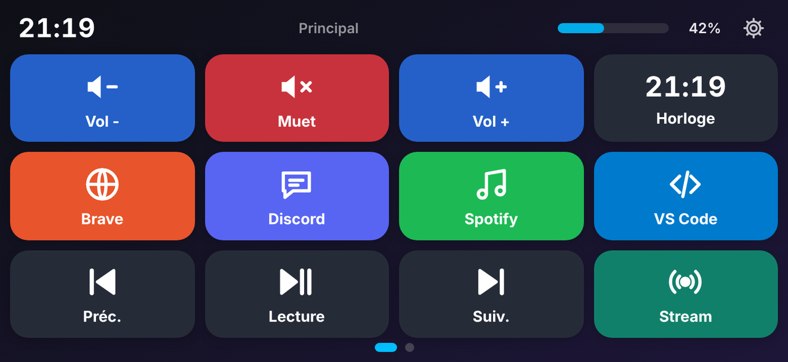
</p>

---

## ✨ Fonctionnalités

| | |
|---|---|
| 🔊 **Son** | Volume +/− (avec répétition en appui long), muet, **curseur de volume** glissable, niveau réel affiché en direct |
| 🚀 **Lanceurs** | Applications installées sur le PC (choisies dans une liste), programmes, dossiers, fichiers, sites web |
| ⌨️ **Raccourcis clavier** | N'importe quelle combinaison : `ctrl+shift+m`, `win+shift+s`, `alt+tab`… |
| 🎵 **Multimédia** | Lecture/pause, piste précédente, piste suivante |
| 🖼️ **Vraies icônes** | Le logo de chaque application est extrait directement de Windows (PNG jusqu'à 256 px), plus une bibliothèque de 60 icônes, les emojis ou ta propre image |
| 📄 **Pages** | Autant de pages que tu veux, navigation par balayage ou par bouton dédié |
| 🎨 **Thèmes** | 8 thèmes prêts (Nuit, Néon, OLED, Océan, Coucher de soleil, Forêt, Clair, Verre) + couleurs, style plein / contour / verre, arrondi, espacement, police, taille des icônes et du texte |
| 🕒 **Horloge** | Appui sur l'heure = horloge plein écran ; écran de veille automatique (24 h/12 h, secondes, date, couleurs) |
| ⚙️ **Paramètres sur l'écran** | Tout se règle depuis le bouton ⚙ de l'interface, avec aperçu en direct, protégé par un **code PIN** |
| 💾 **Profils** | Export / import de la configuration en JSON (profil jeu, travail, stream…) |
| 🔄 **Multi-écrans** | Plusieurs téléphones / tablettes en même temps, synchronisés automatiquement |
| 📦 **Léger** | Un seul script Python côté PC, interface web en JavaScript pur (aucun framework, aucun build) |

---

## 📱 Sur quels appareils ?

Le PC fait tourner un petit serveur ; l'écran de contrôle n'est qu'une **page web**. N'importe quel appareil avec un navigateur fait l'affaire :

| Appareil | Comment | Idéal pour |
|---|---|---|
| 📱 **Téléphone** (même un vieux) | Ouvrir `http://<IP-du-PC>:8765` dans Chrome, sur le même WiFi | Recycler un ancien smartphone en Stream Deck à 0 € |
| 📟 **Tablette** | Même adresse, grandes cases très lisibles | Un vrai panneau de contrôle de bureau |
| 💻 **Le PC lui-même** | `http://localhost:8765`, ou en fenêtre d'application (voir ci-dessous) | Un 2ᵉ écran, un écran tactile de PC portable |
| 🖥️ **Un autre PC** | `http://<IP-du-PC>:8765` depuis le réseau local | Piloter le PC de stream depuis un autre poste |

<p align="center">
  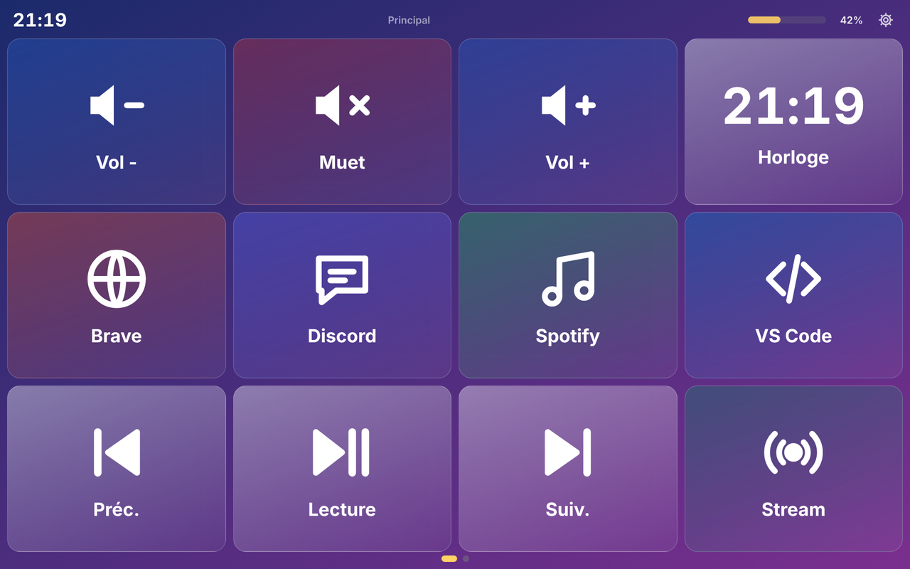
  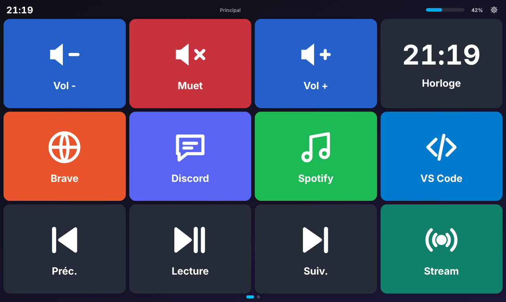
  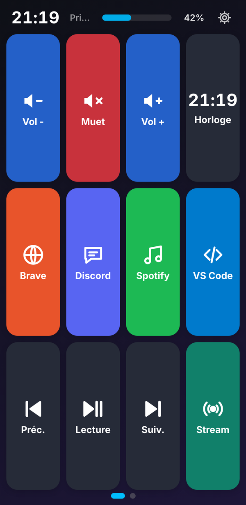
</p>

---

## 🚀 Installation

**Prérequis :** Python 3.9 ou plus récent ([python.org](https://www.python.org/downloads/) — cocher *Add python.exe to PATH*).

```bash
git clone https://github.com/yacinehrc/StreamDeck_Python.git
cd StreamDeck_Python
pip install -r requirements.txt
```

> Sous Windows, si `pip` n'est pas reconnu : `py -m pip install -r requirements.txt`

Dépendances : `pycaw` + `comtypes` (volume Windows) et `pyserial` (boîtier USB optionnel). L'interface web n'a **aucune** dépendance.

---

## ▶️ Lancer / ⏹️ arrêter

```bash
py deck_companion.py            # Windows  (Linux / macOS : python3 deck_companion.py)
```

La console affiche :

```
[21:17:15] Sur ce PC             : http://localhost:8765
[21:17:15] Téléphone / tablette  : http://192.168.1.25:8765  (même réseau WiFi)
[21:17:15] Code PIN (paramètres) : 4821   (modifiable dans config.json)
[21:17:15] Ctrl+C pour arrêter.
```

| Action | Commande |
|---|---|
| Lancer (fenêtre visible) | `py deck_companion.py` |
| Lancer + ouvrir l'interface sur ce PC | `py deck_companion.py --open` |
| Lancer en arrière-plan (sans fenêtre) | `pyw deck_companion.py` |
| Arrêter (fenêtre visible) | `Ctrl + C` ou fermer la fenêtre |
| Arrêter (arrière-plan) | `powershell -c "Get-CimInstance Win32_Process \| ? CommandLine -like '*deck_companion*' \| Invoke-CimMethod -Name Terminate"` |

Ou en double-cliquant dans le dossier [`scripts/`](scripts) : `lancer.bat`, `lancer_arriere_plan.bat`, `arreter.bat`.

<details>
<summary><b>Toutes les options</b></summary>

| Option | Effet |
|---|---|
| `--open` | Ouvre l'interface dans le navigateur du PC |
| `--web-port 8765` | Change le port de l'interface web |
| `--host 127.0.0.1` | Interface accessible **uniquement** depuis ce PC |
| `--config chemin.json` | Utilise un autre fichier de configuration (profils) |
| `--serial` / `--port COM5` | Active aussi un boîtier physique USB (ESP32 / Arduino), voir plus bas |
| `--no-web` | Boîtier USB seul, sans interface web |

</details>

### Démarrage automatique avec Windows
1. `Win + R` → `shell:startup` → Entrée
2. Y placer un **raccourci** vers `scripts\lancer_arriere_plan.bat`

---

## 🧭 Prise en main

1. Lance le script et ouvre l'adresse affichée sur ton téléphone / ta tablette.
2. Touche **⚙** (en haut à droite) et entre le **code PIN** affiché dans la console.
3. **Boutons** : touche un bouton de l'aperçu pour le modifier, ou *Ajouter un bouton* → *Choisir une application* : la liste de tes applis s'affiche avec leurs vrais logos.
4. **Apparence** : choisis un thème, ajuste couleurs, arrondis, tailles… L'aperçu se met à jour en direct.
5. **Enregistrer** : tous les écrans connectés se mettent à jour.

<p align="center">
  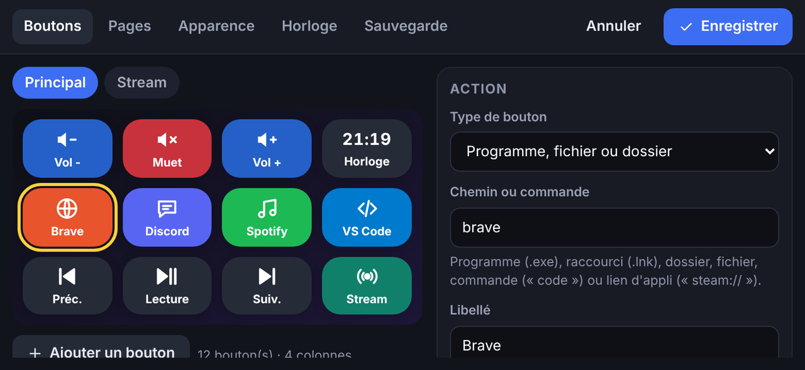
  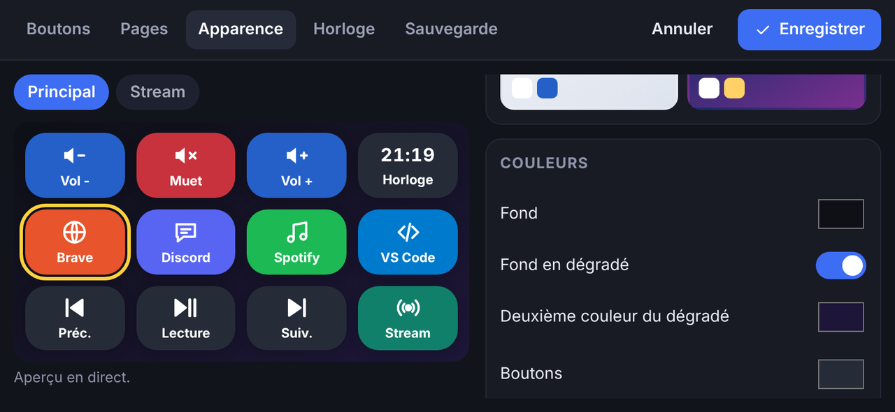
</p>

### Types de boutons

| Type | Action sur le PC |
|---|---|
| Application du PC | Lance une appli du menu Démarrer (classique ou Microsoft Store), avec son logo |
| Programme, fichier ou dossier | Ouvre un `.exe`, un `.lnk`, un dossier, un fichier, une commande (`code`) ou un lien d'appli (`steam://`, `spotify:`) |
| Site web | Ouvre l'URL dans le navigateur par défaut du PC |
| Raccourci clavier | Envoie la combinaison au PC (`ctrl`, `shift`, `alt`, `win`, `a–z`, `0–9`, `f1–f24`, `esc`, `enter`, `tab`, `space`, flèches, `printscreen`…) |
| Volume − / + / Muet | Règle le son du PC (appui long = répétition) |
| Curseur de volume | Glisser pour régler le volume au pourcentage près |
| Lecture / Précédent / Suivant | Touches multimédia (Spotify, YouTube, VLC…) |
| Horloge | Affiche l'heure ; un appui l'ouvre en plein écran |
| Aller à une page | Navigation entre pages (dossiers de boutons) |
| Case vide | Espace pour aérer la grille |

<p align="center">
  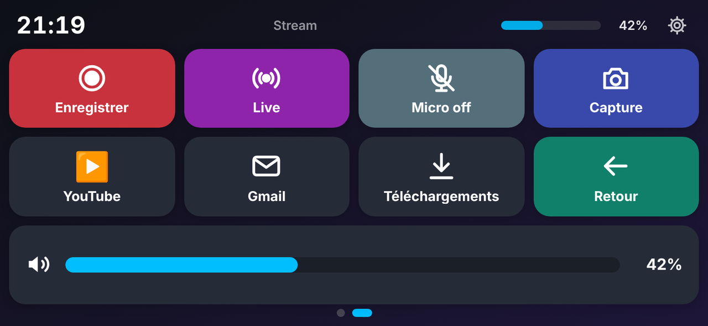
  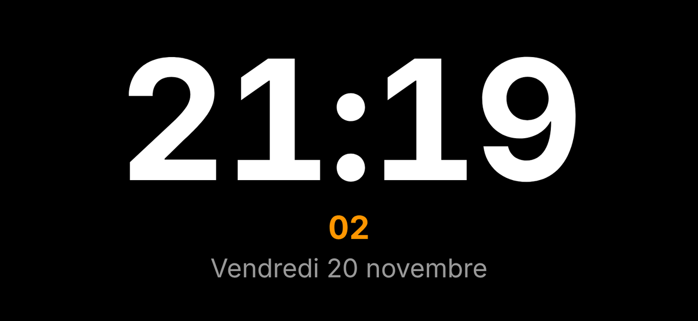
</p>
<p align="center">
  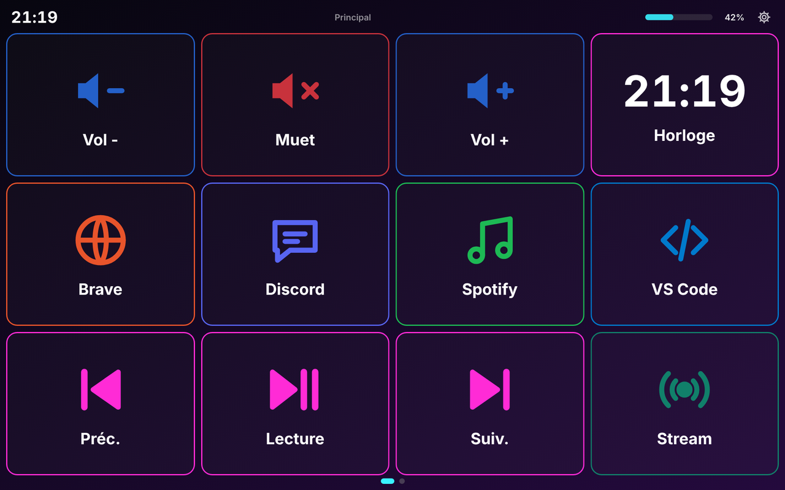
  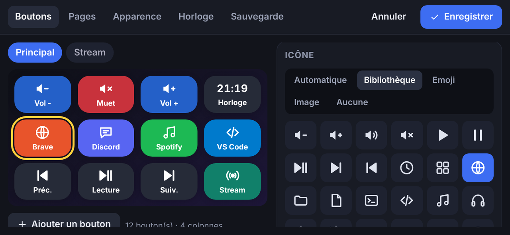
</p>

### Astuces d'affichage

- **Téléphone / tablette en plein écran :** l'interface passe en plein écran au premier toucher. Pour une vraie « appli kiosque » (écran toujours allumé, lancement au démarrage) : [Fully Kiosk Browser](https://play.google.com/store/apps/details?id=de.ozerov.fully) sur Android.
- **Écran toujours allumé :** options développeur Android → *Rester activé* (pendant la charge).
- **Sur le PC, en fenêtre d'application** (sans barre d'adresse) :
  ```bash
  start brave --app=http://localhost:8765      # ou: start msedge --app=... / start chrome --app=...
  ```

---

## 🏗️ Architecture

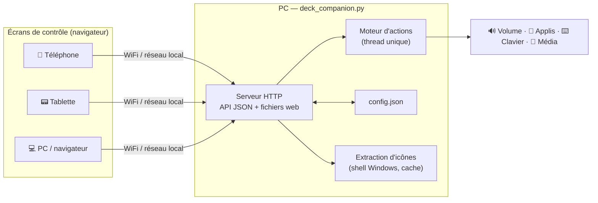

- **Front** (`web/`) : HTML/CSS/JS sans framework ni build. Le rendu s'adapte à la taille de l'écran (grille CSS, tailles d'icônes calculées), les réglages sont édités sur une copie avec aperçu en direct puis envoyés au PC.
- **Back** (`deck_companion.py`) : `http.server` de la bibliothèque standard, un thread unique pour toutes les actions système (nécessaire pour COM sous Windows), validation stricte de la configuration.
- **Windows natif** (`winshell.py`, ctypes uniquement) : liste des applis via `Get-StartApps`, logos via `IShellItemImageFactory` (méthode de l'Explorateur, applis Store comprises) avec repli sur la liste d'images système, encodage PNG fait main, raccourcis clavier via `keybd_event`.

### Structure

```
StreamDeck_Python/
├── deck_companion.py     # serveur + moteur d'actions (volume, applis, raccourcis…)
├── winshell.py           # Windows : applis du menu Démarrer, icônes PNG, raccourcis clavier
├── requirements.txt
├── web/
│   ├── index.html
│   ├── app.js            # interface + éditeur de paramètres (vanilla JS)
│   ├── style.css         # thèmes via variables CSS
│   ├── icons.js          # 60 icônes SVG dessinées pour le projet
│   └── manifest.webmanifest
├── scripts/              # lancer / lancer en arrière-plan / arrêter (Windows)
├── docs/screenshots/
└── config.json           # créé au 1er lancement (non versionné : contient le PIN)
```

### API

| Méthode | Route | Rôle | PIN |
|---|---|---|---|
| `GET` | `/api/config` | Configuration (pages, boutons, thème) | — |
| `GET` | `/api/state` | Volume, muet, révision de config | — |
| `POST` | `/api/press` `{id}` | Exécute le bouton `id` enregistré | — |
| `POST` | `/api/volume` `{level}` | Règle le volume (0–100) | — |
| `POST` | `/api/auth` `{pin}` | Vérifie le code PIN | — |
| `POST` | `/api/config` `{config}` | Enregistre la configuration | ✅ |
| `GET` | `/api/apps` | Applications installées sur le PC | ✅ |
| `GET` | `/api/icon?kind=app&id=…` | Logo PNG d'une application | — |

---

## 🔒 Sécurité

- L'écran n'envoie **que l'identifiant d'un bouton** : le PC n'exécute que les actions déjà enregistrées dans `config.json`, jamais une commande arbitraire.
- Toute modification de la configuration exige le **code PIN** (aléatoire au 1er lancement, 5 essais par minute maximum).
- La configuration reçue est **validée champ par champ** (types de boutons, couleurs, URL `http(s)` uniquement, raccourcis reconnus, taille des images…).
- Conçu pour le **réseau local** : ne pas exposer le port 8765 sur Internet. `--host 127.0.0.1` limite l'accès au PC lui-même.

---

## 💻 Compatibilité

| Fonction | Windows 10/11 | Linux | macOS |
|---|:---:|:---:|:---:|
| Volume + niveau affiché | ✅ pycaw | ✅ `pactl` | ✅ AppleScript |
| Multimédia | ✅ | ✅ `playerctl` | ⚠️ Spotify |
| Liste des applis | ✅ menu Démarrer + Store | ✅ fichiers `.desktop` | ✅ `/Applications` |
| Vrais logos | ✅ | ✅ (thème d'icônes) | ❌ pictogrammes |
| Raccourcis clavier | ✅ | ✅ `xdotool` | ⚠️ partiel |

---

## 🛠️ Dépannage

| Problème | Solution |
|---|---|
| `pip` / `python` non reconnu | Réinstaller Python en cochant *Add python.exe to PATH*, ou utiliser `py -m pip` / `py` |
| La page ne s'ouvre pas sur le téléphone | Même WiFi que le PC ? Profil réseau Windows en **Privé** ? Python autorisé dans le pare-feu ? `http://` (pas `https`) et `:8765` |
| « Port 8765 indisponible » | Le script tourne déjà : l'arrêter ou utiliser `--web-port 8766` |
| `can't open file … deck_companion.py` | Lancer la commande **depuis le dossier du projet** (`cd` dedans) |
| Un logo ne s'affiche pas | Un pictogramme de remplacement est utilisé ; supprimer `icons_cache/` puis relancer |
| PIN oublié | Il est dans `config.json` (clé `"pin"`) |

---

## 🗺️ Pistes d'évolution

- [ ] Boutons « multi-actions » (macro : plusieurs actions à la suite)
- [ ] Bouton à état (micro coupé / actif) lu depuis le PC
- [ ] Profils automatiques selon l'application au premier plan
- [ ] Intégration OBS (WebSocket) : scènes, enregistrement, live
- [ ] Version matérielle autonome : écran tactile ESP32-S3 7" relié en WiFi au même serveur

---

## 📄 Licence

[MIT](LICENSE) — libre de l'utiliser, de le modifier et de le partager.

---

## 🐙 Publier ce projet sur GitHub

1. Sur [github.com/new](https://github.com/new) : nom **`StreamDeck_Python`**, **Public**, et **ne coche rien** (pas de README, pas de .gitignore, pas de licence : ils sont déjà là).
2. Dans un terminal, **depuis le dossier du projet** :

```bash
cd "%USERPROFILE%\Bureau\StreamDeck_Python"     # cmd   (PowerShell : cd "$HOME\Bureau\StreamDeck_Python")

git init
git add .
git commit -m "StreamDeck Python : télécommande tactile pour PC"
git branch -M main
git remote add origin https://github.com/yacinehrc/StreamDeck_Python.git
git push -u origin main
```

**Mises à jour suivantes :**

```bash
git add .
git commit -m "Description de la modification"
git push
```

<details>
<summary>Première utilisation de Git sur ce PC</summary>

```bash
winget install --id Git.Git -e          # installer Git (puis rouvrir le terminal)
git config --global user.name  "Ton Nom"
git config --global user.email "ton-email@exemple.com"
```

Au premier `git push`, une fenêtre de connexion GitHub s'ouvre dans le navigateur.

Avec **GitHub CLI** (`winget install GitHub.cli`, puis `gh auth login`), une seule commande crée le dépôt et l'envoie :

```bash
gh repo create StreamDeck_Python --public --source=. --push
```

</details>
